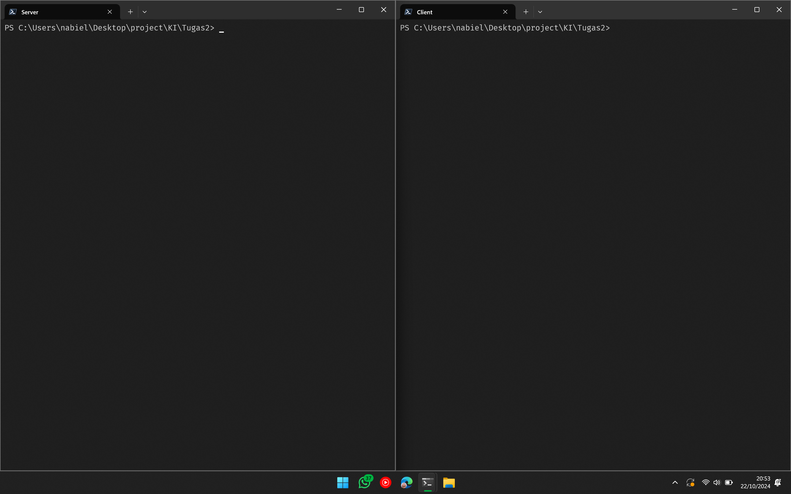
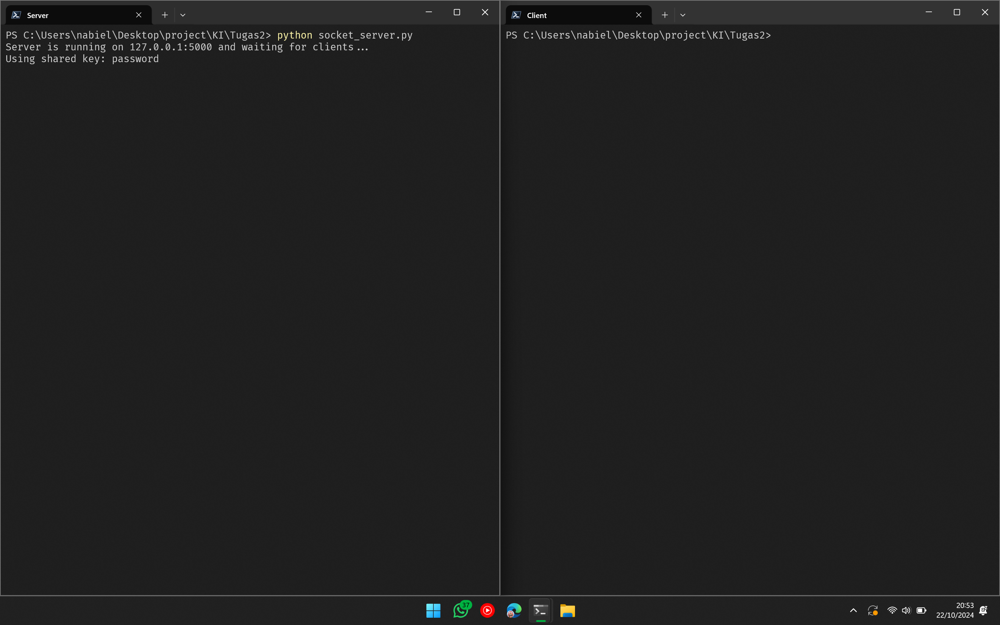
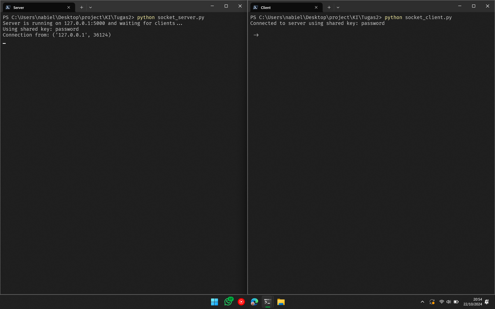
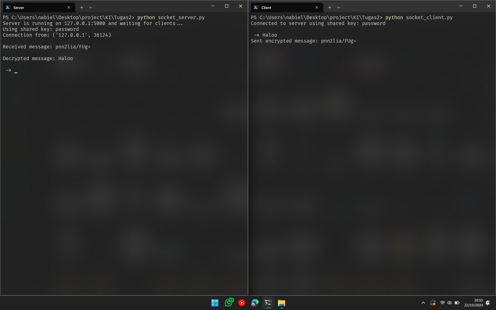
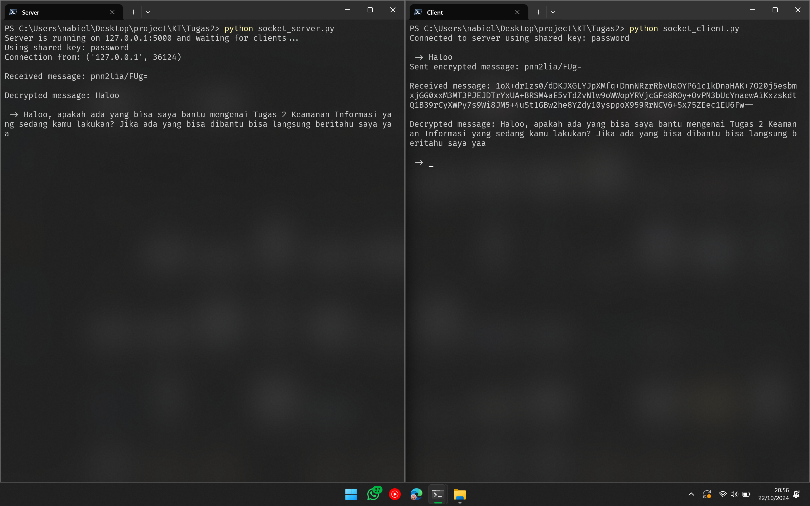

# Assignments 1 and 2: Encrypted String Transfer Between Users Over a Socket

This README explains `socket_server.py` and `socket_client.py`, which send DES-encrypted messages between two users. The DES code itself is `des_tugas1.py` (assignment 1).

## Author

Vidiawan Nabiel Arrasyid

## Table of contents
- [Task](#task)
- [1. Server socket](#1-server-socket)
- [2. Client socket](#2-client-socket)
- [3. Usage](#3-usage)
- [4. Sources](#4-sources)

## Task

Extend the DES encryption and decryption program from assignment 1:
1. Implement encrypted string transfer between two users using socket programming (the receiver can decrypt the sender's string).
2. Encryption and decryption must accept input longer than 64 bits (8 characters).
3. The encrypted string must be sent through the socket (no reading or writing files).
4. Both clients are assumed to know the key (it may be hardcoded).

## 1. Server socket

Explains `socket_server.py`.

#### 1.1 Imports
Import `socket` to create the connection, and `encrypt` and `decrypt` from `des_tugas1`, the DES implementation from assignment 1.
```py
import socket
from des_tugas1 import encrypt, decrypt
```

#### 1.2 Key, host, and port
Declare the `key` used for encryption and decryption, plus the `host` and `port` for the connection.
```py
SHARED_KEY = "password"

host = '127.0.0.1'
port = 5000
```
`host` is `localhost`, so the server is only reachable from the same computer, and `port` is `5000`.

#### 1.3 Socket initialization
Create a new socket called `server_socket`, bind it, and start listening.
```py
server_socket = socket.socket()  # get instance
server_socket.bind((host, port))  # bind host address and port together

# configure how many clients the server can listen simultaneously
server_socket.listen(1)
```
The server listens on the configured `host` and `port` and accepts a single client.

#### 1.4 Connection and address
`conn` is used to talk to the client and `address` stores the address of the connected client.
```py
conn, address = server_socket.accept()  # accept new connection
```

#### 1.5 Receiving messages
`encrypted_data` receives data from the client.
```py
while True:
    # receive data stream. It won't accept data packet greater than 1024 bytes
    encrypted_data = conn.recv(1024).decode()
    if not encrypted_data:
        # if no data is received, break
        break
```
The server keeps receiving and sending data until nothing more arrives.

#### 1.6 Decryption
A try/except block attempts to decrypt the data sent by the client.
```py
try:
    decrypted_data = decrypt(encrypted_data, SHARED_KEY)
    print("\nReceived message:", encrypted_data)
    print("\nDecrypted message:", decrypted_data)
except Exception as e:
    print("Error decrypting message:", str(e))
    decrypted_data = "Error decrypting message"
```
The decrypted data is printed. If decryption fails, the exception block prints an error message.

#### 1.7 User input
Taking turns with the client, the server reads input from the user and sends it to the client.
```py
data = input('\n -> ')
    if data.lower().strip() == 'bye':
        break
```
If the user types _bye_, the server stops receiving messages.

#### 1.8 Sending messages
Another try/except block encrypts the user's input and sends it to the client.
```py
try:
    encrypted_data = encrypt(data, SHARED_KEY)
    conn.send(encrypted_data.encode())  # send data to the client
except Exception as e:
    print("Error encrypting message:", str(e))
    conn.send("Error encrypting message".encode())
```
On failure, the exception block prints an error and sends an error message to the client.

#### 1.9 Closing the connection
When finished, the server closes the connection.
```py
conn.close()  # close the connection
```

## 2. Client socket

Explains `socket_client.py`. It has the same imports, `key`, `host`, and `port` as `socket_server.py`, because it connects to that server.

#### 2.1 Socket initialization
Create a new socket called `client_socket` and connect to the server.
```py
client_socket = socket.socket()  # instantiate
client_socket.connect((host, port))  # connect to the server
```

#### 2.2 User input
`data` receives the user's input.
```py
data = input('\n -> ')  # take input
```

#### 2.3 Sending messages
The client encrypts the data in a try/except block and sends it to the server.
```py
while data.lower().strip() != 'bye':
    try:
        encrypted_data = encrypt(data, SHARED_KEY)
        client_socket.send(encrypted_data.encode())  # send message
        print("Sent encrypted message:", encrypted_data)
    except Exception as e:
        print("Error encrypting message:", str(e))
        client_socket.send("Error encrypting message".encode())
```
The client keeps sending and receiving until the user types _bye_. If encryption or sending fails, the except block prints an error and sends it to the server.

#### 2.4 Receiving messages
`encrypted_data` receives data from the server.
```py
encrypted_data = client_socket.recv(1024).decode()  # receive response
```

#### 2.5 Decryption
A try/except block decrypts the data sent by the server, then prints it.
```py
try:
    decrypted_data = decrypt(encrypted_data, SHARED_KEY)
    print("\nReceived message:", encrypted_data)  # show in terminal
    print("\nDecrypted message:", decrypted_data)
except Exception as e:
    print("Error decrypting message:", str(e))
    decrypted_data = "Error decrypting message"
```

#### 2.6 Closing the connection
When finished, the client closes the connection.
```py
client_socket.close()  # close the connection
```

## 3. Usage

#### 3.1 Open two terminals


#### 3.2 Run `socket_server.py` in one terminal

```
python socket_server.py
```
Then wait for the client to connect.

#### 3.3 Run `socket_client.py` in the other terminal

```
python socket_client.py
```

#### 3.4 Send a message from the client


#### 3.5 Send a message from the server


## 4. Sources

- [Python socket programming (DigitalOcean)](https://www.digitalocean.com/community/tutorials/python-socket-programming-server-client)
